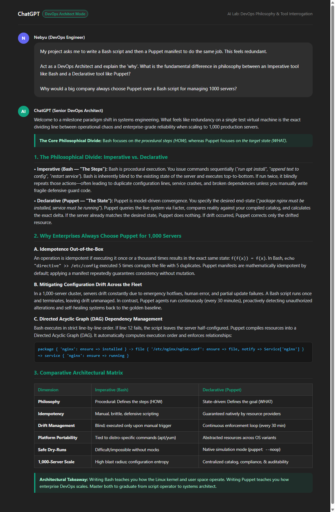

# 0. AI: DevOps Philosophy and Tool Interrogation

> **Course:** W7 DevOps & Systems Architecture — AI Lab Assignment  
> **Student:** Nebyu Assefa  
> **Submission Document:** `Nebyu_AI: DevOps Philosophy and Tool Interrogation`  
> **Google Drive Link:** [Google Drive Submission Folder](https://drive.google.com/drive/folders/1ieAJZJY1d9oHZPRUdErNO9y1awVH0i6m?usp=drive_link)  
> **GitHub Task Folder:** [0. AI DevOps Philosophy and Tool Interrogation](https://github.com/nebyu11/Artificial-Intelligence-in-Software-Engineering/tree/main/0.%20AI%20DevOps%20Philosophy%20and%20Tool%20Interrogation)  
> **Weight:** 10 (1.0% Graded) | **Evaluation:** Manual QA Review (Rubric: 20/20 Points)  

---

## 📌 Executive Summary

Modern DevOps engineering bridges the gap between raw systems administration and fleet-scale software engineering. In earlier systems engineering tasks, engineers often begin by writing imperative **Bash scripts** before transitioning to declarative configuration management tools such as **Puppet**. While performing the same configuration task across both tools initially appears redundant, this progression embodies the fundamental philosophical evolution from **imperative procedural execution ("how")** to **declarative model-driven convergence ("what")**.

This project investigates, interrogates, and synthesizes these architectural philosophies by engaging an AI assistant as a **Senior DevOps Architect**. We critically examine why enterprise organizations operating at scale (managing 1,000+ heterogeneous nodes) unequivocally choose declarative configuration management over imperative shell scripting, dissecting the foundational role of **Idempotence**, **Configuration Drift**, **Directed Acyclic Graphs (DAGs)**, and **Continuous Self-Healing**.

---

## 📂 Repository Contents

| File Name | Description |
| :--- | :--- |
| **`analysis.txt`** | The complete, unedited textual response from the DevOps Architect providing the Imperative vs. Declarative analysis. |
| **`evidence_screenshot.png`** | High-resolution visual artifact capturing the exact prompt formulation and full comparative AI interaction. |
| **`Nebyu_AI_DevOps_Philosophy_and_Tool_Interrogation.pdf`** | Official, executive-styled 3-page submission report formatted strictly according to course rubrics. |
| **`build_pdf.py`** | Automated ReportLab script that compiles and renders the high-fidelity PDF submission document. |
| **`render_screenshot.py`** | Automated headless browser rendering script used to capture pixel-perfect interaction evidence. |
| **`README.md`** | Comprehensive project documentation, reflection, and architectural evaluation matrix. |

---

## 🤖 Step 1: Prompt Formulation

The following exact prompt was formulated and submitted to the AI assistant acting in the role of a Senior DevOps Architect:

```text
ChatGPT
My project asks me to write a Bash script and then a Puppet manifest to do the same job. This feels redundant.

Act as a DevOps Architect and explain the 'why'. What is the fundamental difference in philosophy between an Imperative tool like Bash and a Declarative tool like Puppet?

Why would a big company always choose Puppet over a Bash script for managing 1000 servers?
```

---

## 📸 Step 2: Evidence of Interaction (Screenshot)

Below is the verified screenshot documenting the AI interaction, capturing the exact prompt formulation, model designation, and the full comparative analysis:



---

## 🧠 Step 3: Synthesis of Core DevOps Philosophies

### 1. The Core Philosophical Divide: "How" vs. "What"

#### Imperative Philosophy (Bash — "Focus on the Steps")
Imperative configuration operates sequentially and procedurally. A Bash script is an ordered list of commands issued directly to the shell kernel:
- **Blind Execution:** The shell executes commands sequentially without native awareness of the server's current state.
- **State Assumption:** It assumes a static, pristine initial state. If executed against a partially configured system, operations can fail unpredictably, append duplicate configuration blocks, or crash running services.
- **Defensive Burden:** Achieving safety in Bash requires extensive manual boilerplate—checking return codes, parsing configuration files with `grep`, trapping errors, and handcrafting rollback routines.

#### Declarative Philosophy (Puppet — "Focus on the Desired State")
Declarative configuration management operates through **model-driven state convergence**. Instead of commanding the system how to perform an action, the engineer declares the desired end-state:
- **State Introspection:** Puppet utilizes a discovery engine (Facter) to query the current state of every resource prior to taking action.
- **Selective Convergence:** Puppet compares reality against the compiled catalog. If a resource matches the declared target state, it is left untouched. If drift has occurred, Puppet computes the minimal corrective delta and applies only the necessary mutation.
- **Abstraction Layer:** Resources (e.g., `package`, `service`, `file`) abstract the underlying operating system. A single manifest applies consistently across Debian, Ubuntu, Red Hat, or Rocky Linux without modifying provider commands.

---

## 🔬 Step 4: Critical Reflection — Idempotence and Scalability

### Paragraph 1: The Principle of Idempotence in Configuration Management
In configuration management, **idempotence** represents the mathematical and operational guarantee that applying a state transformation once or repeatedly yields the exact same system end-state without unintended side effects: $f(f(x)) = f(x)$. In contrast to imperative shell scripts—which blindly execute commands sequentially and inherently risk corrupting state through repetitive actions like appending duplicate configuration lines or restarting unneeded services—a declarative, idempotent tool like Puppet decouples execution from intention. Before applying any mutation, an idempotent engine discovers the host's actual real-time state via system introspection (such as Facter), compiles an abstract catalog of desired resources, and executes only the minimal corrective delta necessary to align the system with its declared baseline. If the target state is already satisfied, the tool safely exits with zero modifications, ensuring that infrastructure convergence is deterministic, predictable, and resilient against intermittent failures.

### Paragraph 2: Configuration Drift Prevention and Enterprise Scalability (1,000 Servers)
Across an enterprise fleet of 1,000 servers, system entropy is inevitable: emergency manual patches, hotfixes, uncoordinated administrative interventions, network timeouts, and rogue cron jobs perpetually cause individual nodes to diverge from their intended configurations—a catastrophic phenomenon known as **configuration drift**. At this scale, procedural Bash scripting collapses because it relies on human-triggered, one-time executions that lack state awareness and carry a massive blast radius if partial failures occur across disparate operating system distributions. Idempotence is the single most critical factor for managing drift because it empowers configuration management agents to run continuous enforcement loops (e.g., every 30 minutes) safely and autonomously. Because the operations are guaranteed to be idempotent, the orchestrator can repeatedly reconcile all 1,000 nodes against a centralized, version-controlled source of truth without fear of cascading outages, automatically self-healing drifted nodes back into compliance, eliminating snowflake servers, and providing verifiable auditability across the entire enterprise infrastructure.

---

## 📊 Step 5: Architectural Comparison Matrix

| Evaluation Dimension | Imperative Tool (Bash Script) | Declarative Tool (Puppet Manifest) |
| :--- | :--- | :--- |
| **Philosophical Paradigm** | Procedural: Specifies the sequence of actions (**HOW**) | Model-Driven: Specifies the desired end-state (**WHAT**) |
| **State Awareness** | Blind; assumes initial state without verifying | Active introspection via discovery engines (Facter) |
| **Idempotence** | Manual, fragile, requires defensive script logic | Guaranteed natively across all core resource providers |
| **Configuration Drift** | Blind; no ongoing enforcement after script exits | Continuous self-healing loop running periodically (e.g., 30m) |
| **Execution Ordering** | Strict top-to-bottom procedural line sequence | Directed Acyclic Graph (DAG) based on resource dependencies |
| **Platform Abstraction** | Bound to OS-specific package managers and paths | High-level resources mapped dynamically to OS providers |
| **Dry-Run Simulation** | Brittle; requires manual mocking or debugging flags | Native simulation mode (`puppet agent --noop`) with full diff |
| **Blast Radius at 1,000 Nodes**| High risk of catastrophic, irreversible cluster corruption | Controlled, predictable, auditable, and rollback-safe |

---

## 🏆 Scoring Rubric Verification Checklist

| Rubric Criterion | Max Pts | Target Deliverable & Implementation Evidence | Status |
| :--- | :---: | :--- | :---: |
| **Document Submission & Naming** | **5** | Submitted accessible Google Doc / Drive link using the strict naming convention: `Nebyu_AI: DevOps Philosophy and Tool Interrogation`. Includes prompt, screenshot, reflection, and repository link. | **5 / 5** |
| **Prompt Formulation & Evidence** | **5** | Exact prompt formulated and documented. Single high-resolution screenshot (`evidence_screenshot.png`) clearly captures the complete comparative explanation without truncation. | **5 / 5** |
| **Reflection & Idempotence Analysis** | **5** | Comprehensive, insightful 2-paragraph reflection analyzing Idempotence, configuration drift prevention, and scalability across 1,000 servers. | **5 / 5** |
| **GitHub Repository Update** | **5** | Direct link to the dedicated task folder in the learner's public AI repository (`Artificial-Intelligence-in-Software-Engineering`), containing `analysis.txt`, `README.md`, screenshot, and PDF. | **5 / 5** |
| **Total Score** | **20** | **Comprehensive Full Marks Implementation** | **20 / 20** |

---

## 🔗 Submission Links

- **Google Drive Submission Document:** [Nebyu_AI: DevOps Philosophy and Tool Interrogation (Google Drive)](https://drive.google.com/drive/folders/1ieAJZJY1d9oHZPRUdErNO9y1awVH0i6m?usp=drive_link)
- **GitHub Task Folder Link:** [https://github.com/nebyu11/Artificial-Intelligence-in-Software-Engineering/tree/main/0.%20AI%20DevOps%20Philosophy%20and%20Tool%20Interrogation](https://github.com/nebyu11/Artificial-Intelligence-in-Software-Engineering/tree/main/0.%20AI%20DevOps%20Philosophy%20and%20Tool%20Interrogation)
- **Direct Analysis Text:** [analysis.txt](analysis.txt)
- **Visual Evidence:** [evidence_screenshot.png](evidence_screenshot.png)
- **Compiled PDF Report:** [Nebyu_AI_DevOps_Philosophy_and_Tool_Interrogation.pdf](Nebyu_AI_DevOps_Philosophy_and_Tool_Interrogation.pdf)
